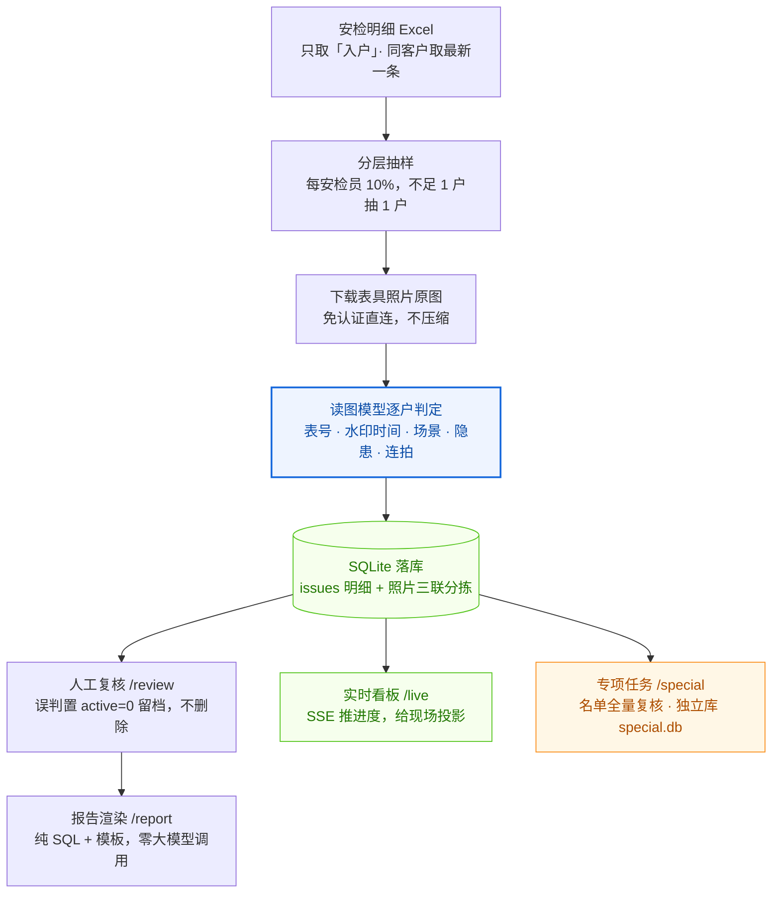

# 安检照片 AI 质检系统（Anjian AI QC）

> **一句话**：把安检员上传的照片批量交给「会看图的 AI」逐张检查，挑出**表号对不上、
> 照片时间不对、不是安检现场、有明显隐患**的户，输出带证据照片的月度报告，人再复核一遍。
>
> 它替代的是「人工一张张翻几千户照片」这件事，**不替代安检员上门**。
>
> 核心思路：读图这一步交给**支持视觉的大模型**，不在程序里另建一套图像识别。
> 程序只负责搬数据、抽样、下载原图、算时间差、落库、渲染报告。
> 生产环境用的模型是 **DeepSeek V4.1 Flash**，也支持换任何支持视觉的模型。



> 上图用 GitHub 原生 Mermaid 渲染，不依赖图床 —— 仓库内 `raw.githubusercontent.com`
> 的图片域名在部分网络下不可达，会显示成裂图。离线版见 [`assets/architecture.svg`](assets/architecture.svg)
> （矢量）与 [`assets/architecture.png`](assets/architecture.png)（2 倍图）。

---

## 运行前提：必须搭配一个「能看图」的模型

照片不会自己变成结论。**判定这一步必须交给支持视觉输入（image input）的大模型**，
程序本身不做图像识别。所以选型的第一件事不是装环境，而是确定用哪个模型读图。

| 项 | 说明 |
|---|---|
| **必须具备** | 视觉能力：能把照片和指令一起送进模型，模型直接回答「表号是多少 / 水印几点 / 是不是安检现场」 |
| **推荐** | **DeepSeek V4.1 Flash** —— 本项目生产环境实测所用模型，6 家分公司 6000+ 户抽样、数万张照片跑通；表号小字与水印时间读得稳，单价低 |
| **也可用** | 任何支持视觉的模型：GPT-4o / Claude Sonnet / Gemini 2.x / Qwen-VL / GLM-4V / 豆包视觉 等，接口按 OpenAI 兼容协议接 |
| **不需要** | 单独的 OCR 服务、自训练目标检测模型、GPU、标注数据 |
| **选型只看四点** | ① 能读清 10–12 位表号小字 ② 能读清水印上的日期时间 ③ 单图能看清原图细节 ④ 价格/额度够跑完当月户数 |

模型放在哪一侧由你定，两种跑法判定口径完全一致：

| 跑法 | 谁在读图 | 要不要 API Key | 适合场景 |
|---|---|---|---|
| **A. Agent 模式（推荐）** | 你在用的对话式 Agent（DeepSeek V4.1 Flash / GPT / Claude …）亲自看 | 不要 | 每月抽查一次、要边看边写复核意见 |
| **B. 程序直调 API** | `ai/models/` 适配层替你调视觉模型 | 要：`base_url` + `api_key` + `model_id` | 无人值守批跑、挂到排班任务里 |

> 换模型只影响读图精度，不影响判定口径（同一份 `docs/SKILL.md` + 同一套 `ai/db.py` 阈值）。
> 设置页 `/settings` 可切换模型来源；Key 只存本机 `ai/config.json`，不进代码、不进报告。
> 读图能力不足的模型会在「表号无法辨认」上虚高，**先用 20 户真实照片试判再定**。

> **接手部署的 Agent 请直接看 [`docs/部署交接.md`](docs/部署交接.md)** ——
> 里面有必须向用户采集的参数清单（分公司、照片列名、抽样口径、判定阈值）、改哪个文件、
> 以及真实数据跑通的验收标准。本文档是给人看的概览，那份是给 Agent 执行的 SOP。

---

## 它能查出什么

| 能查（可靠） | 判定级别 |
|---|---|
| 表号与档案不一致（读条形码下方印刷行，与 Excel 档案核对） | critical |
| 水印日期与工单时间差 ≥168 小时（7 天）——抓跨月复用旧照片 | critical |
| 手写工作单检查日期异常（未来日期 / 早于拍摄日期） | critical |
| 照片内容不是燃气安检现场 | critical |
| 照片明确可见重大隐患（热水器无烟道 / 装浴室 / 软管穿墙 / 表被封死…） | critical |
| 表号无法辨认（拍不清 / 未入镜 / 失焦） | warning |
| 同一检查项内多张照片疑似连拍凑数 | warning |
| 检查项错位（如「热水器」项拍的是安检工作单） | info |

**明确查不出、也不编**：软管老化程度、熄火保护针是否有效、报警器是否工作、
检漏结果、是否真实入户（照片只能证明画面状态，证明不了检查动作）。

**不作为判据**：模糊度（实测与可读性反相关）、手写「防霾卡号」（与表号是另一套编号体系）。

---

## 快速开始

### 1. 环境

```bash
python 3.9+            # 标准库即可跑服务；读图脚本需要下面这些
pip install -r requirements.txt
# config.json 可选：不存在时用内置默认值（抽样 10% / 阈值 168h / 端口 8790）
cp config.example.json ai/config.json
```

> 选 **A 类跑法（Agent 读图）不需要任何 API Key**，Key 由你的 Agent 客户端自己管；
> 选 **B 类跑法（程序直调）** 才需要在上面的 `config.json` 或 `/settings` 里填
> `base_url` / `api_key` / `model_id`。两类跑法都要求模型**支持视觉**。

### 2. 接入你自己的公司

打开 `ai/db.py`，改三张表：

```python
COMPANY_ORDER = [          # ① (公司代码, 显示名)
    ("C1", "A 公司"),
    ("C2", "B 公司"),
]

METER_ITEMS = {            # ② 该公司「表具照片」所在的 items_code
    "C1": ("items4", "items17"),   # 一列就写字符串，两列写元组（前者优先）
    "C3": ("items1",),
}
FORM_ITEMS = {"C1": "items0"}      # ③ 安检单照片所在项，默认 items1

GAS_NATURE_WHITELIST = {   # ④ 「民用」在该公司系统里叫什么
    "C1": ("民用", "乡镇民用"),
    "C2": ("民用", "民用取暖", "煤改气"),
}
```

> 三张表都是**按公司配**，因为不同公司的安检系统给「同一业务含义」分配的 items 编号**不一样**：
> 硬编码 `items2` 会把某家的「安检过程中照片」误标成表具照片。
> 用气性质同理——某家公司把农村煤改气居民写成「煤改气」而不是「民用」，
> 只匹配字面「民用」会整批漏掉。
> 未配置的公司按默认值处理（items2 / items1 / 不拦用气性质），不会静默丢数据。

**抽样池口径**（`db.checkable_cond`，与报告分母完全同口径）：

```
入户  AND  用气性质在白名单内  AND  该户有表具照片  AND  未被标记「查不了」
```

没有表具照片的户**不进抽样池**——抽查的核心是核对表号，连表都没拍到的户抽出来只能产出一条噪声。
被撤销抽样的户会打上 `records.meter_skip=1` 永久排除，否则补抽会反复选回同一户。

### 3. Excel 数据源要求

表头必须包含这些列（照片列只需列名里带「照片」或「图片」）：

```
客户编号 · 客户姓名 · 客户电话 · 客户类型 · 小区 · 客户地址
安检状态 · 到访不遇次数 · 安检时间 · 安检员
安检计划名称 · 安检计划类型 · 表类型 · 表品牌表型号 · 用气性质 · 表号 · 隐患明细
+ 若干「XX照片」列（值为图片 URL，多行分隔）
```

只处理 `安检状态 == 入户` 的行；同一客户编号（同一来源文件内）取最新一条安检记录。
照片列的值是图片 URL（单元格内多行用换行分隔）；URL 里的 `-f_itemsN` 后缀决定它属于哪个检查项，
没有后缀的按「列名 → items_code」映射兜底（映射从库内历史数据反查，首次导入读表头样本）。

### 4. 启动

```bash
cd ai
python server.py          # 或双击根目录「启动质检系统.bat」
# 打开 http://127.0.0.1:8790/
```

### 5. 跑一次质检

**方式一：交给 Agent（推荐）**

把 `docs/SKILL.md` 作为工作流说明喂给**具备读图能力的 Agent**（如 DeepSeek V4.1 Flash、
GPT-4o、Claude Sonnet 等任意支持视觉的模型），然后说：

```
启动安检抽查 <xlsx 绝对路径>
```

Agent 会自动完成 导入 → 抽样 → 下载 → 亲自读图逐户判定 → 落库 → 出报告。

**方式二：命令行**

```bash
cd ai
python cli.py prepare --file "<xlsx>" --limit 0 --workers 6 --fresh  # 导入+抽样+下载
python scripts/batch.py pack --n 32 --company C1 --month 2026-09
#    → 按 reports/_packs/b<N>/checklist.md 直读原图，写 reports/_batch<N>.json
#    （2026-11 起默认不出水印条带/表号联排图；要出得显式加 --sheets，且不作为判定依据）
python scripts/batch.py gap      --file reports/_batch<N>.json      # 水印间隔核算
python scripts/batch.py precheck --file reports/_batch<N>.json      # 提交前预检
python cli.py bulk               --file reports/_batch<N>.json      # 批量落库
python scripts/batch.py postcheck --batch <N> --payload reports/_batch<N>.json
python cli.py finish --month 2026-09
```

---

## 六个页面

| 页面 | 地址 | 用途 |
|---|---|---|
| 总览 | `/` | 各分公司进度卡片 + 断点续传状态 + **时间范围切换**（单月 / 上月 / 全年 / 上年 / 自定义区间 / 全部），右上角有本地照片清理提醒 |
| 实时看板 | `/live` | 大字进度条 + 当前户 + 实时问题流，给领导投影用 |
| 人工复核 | `/review` | 逐户过有问题的人；三档按钮（`1` 误判 / `↑` 一般提示 / `↓` 严重提示 / `←` `→` 翻页）+ 现场问题多选标签；顶栏可切月份，也可切到**专项任务**队列 |
| 月度报告 | `/report` | 「情况说明」四块分组（抽查范围 / 人工审核 / 问题发现 / 符合率）+ 各分公司卡片，可单家下载、导出 Excel、**导入公司回填的反馈** |
| 专项任务 | `/special` | 按名单做全量复核（不抽样），独立库、不碰主库；汇总 + 问题清单 + 复核工作台同页 |
| 设置 | `/settings` | 模型来源、抽样比例、并发、费用上限、待删保留天数 |

**报告下载三种形态**：

| 形态 | 入口 | 用途 |
|---|---|---|
| HTML 报告 | 报告页「下载」/ `cli.py report` | 发领导；`--embed` 版照片内嵌单文件，非 `--embed` 版走外链几百 KB |
| Excel 明细表 | 报告页「导出Excel」 | 一户一行，照片只给链接，末列「公司反馈」留空给分公司填 |
| 公司反馈回填 | 报告页「导入公司反馈」 | 读回填的 Excel，把「公司反馈」写进该户的人工审核意见，不改判定 |

---

## 时间范围（2026-11 起）

总览与报告统一按月份字符串 `YYYY-MM` 取数，**同一组参数贯穿所有接口**，保证「总览数字 = 报告数字」：

```
?period=month&month=2026-10     单月
?period=year&year=2026          全年
?period=lastyear | lastmonth    上年 / 上月
?period=custom&mfrom=2026-08&mto=2026-10   自定义区间（含两端）
?period=all                     全部
```

多月并存靠 `records` 的唯一约束 `(company, cust_no, src_file)` —— 同一客户 9 月、10 月各一条记录互不覆盖。
**老库升级时会自动重建该表并原样搬迁 `id`**（checks / issues / reviews / photos 全按 `record_id` 关联，id 变了历史复核意见会成孤儿）。

---

## 判定口径（核心约定）

| 现象 | 级别 |
|---|---|
| 读出的表号 ≠ 档案表号 | critical |
| 表号无法辨认（一次读不出即记，不反复精查） | warning |
| 水印与工单时间差 **≥168 小时** | critical |
| 水印与工单时间差 **<168 小时** | 不标记（先拍照后补工单属正常） |
| 手写检查日期异常 | critical |
| 照片非燃气安检现场 | critical |
| 照片明确可见重大隐患 | critical |
| 同检查项照片连拍重复 | warning |
| 手写防霾卡号 / 表面积尘污渍 | 不查 |

**阈值单点**：168h 定义在 `ai/db.py: TIME_GAP_MIN`，改这一处全系统生效。

**一户一档、critical 优先**：同一户同时有 critical 与 warning 时只计入 critical
（取 `MIN(eff_severity)`，字符串序 `'critical' < 'warning'`），否则问题户数会重复计算。

### 三条铁律（错判比漏报更严重）

1. **读图直读表具照片原图（1 张/户）**，禁止用裁切带、联排拼图做主判定。
   裁切会切掉画面底部的表号，并让模型编造「表号在画面之外」的理由——
   实测把「表号无法辨认」率从 4% 抬到 60%+。
2. **读不出就填 `null` / `false`，绝不猜测补全。**
   表号读不出时**不要填 `meter_readable=false`**（程序会机械追加 critical），
   改为手写一条 warning issue。
3. **凡水印读数会翻转结论的户（跨月 / 超 7 天 / 边界带），必须放大复核后才定稿。**

---

## 项目结构

```
anjian-ai-qc/
├── ai/
│   ├── server.py           HTTP 服务（Python 标准库，零依赖）+ SSE 实时推送
│   ├── runner.py           编排：导入 → 抽样 → 下载 → 检测 → 分拣
│   ├── engine.py           判定规则 + 提示词 + 照片分拣
│   ├── db.py               SQLite（WAL）+ 口径常量 + 公司/items/用气性质映射  ← 接自己的数据改这里
│   ├── cli.py              Agent 通道命令行（prepare/next/submit/bulk/status/finish/report）
│   ├── report_data.py      报告数据层（分公司汇总、复核裁决、可查户分母）
│   ├── report_render.py    报告渲染（纯 SQL + 模板，零大模型调用）
│   ├── report_xlsx.py      抽查明细 Excel 导出 / 公司反馈回填
│   ├── _bulk_many.py       批量落库助手（一次进程连续 bulk，失败自动重试）
│   ├── special_server.py   专项任务子系统（独立库 special/special.db，主库只读）
│   ├── special_report.py   专项任务报告（外链版 HTML）
│   ├── special_xlsx.py     专项任务 Excel 导出
│   ├── models/             模型适配层：填 base_url/key/model_id 即换视觉模型（默认 DeepSeek）
│   ├── static/             前端页面（原生 HTML/CSS/JS，无构建步骤）
│   ├── scripts/
│   │   ├── batch.py        批处理：pack / gap / precheck / postcheck
│   │   ├── barcode*.py     条码解码交叉验证（pyzbar + zxingcpp）
│   │   ├── ocr_meter.py    OCR 读表号（RapidOCR）
│   │   ├── meter_band.py   自动定位表号带
│   │   ├── packpool.py     按 rid 池切分打包，避免重复领同一批户
│   │   └── acceptance.py   三轮验收（数据一致性 / 误判撤销 / 报告 / 接口健壮性）
│   ├── special/tools/      专项任务命令行（建单/下载照片/补导辅助照片/领批/落判定）
│   ├── photos/             有问题的照片（证据留存，运行时生成）
│   ├── pending_delete/     无问题照片（运行时生成，按月份定期清理）
│   ├── false_positive/     人工复核判「误判」的照片（永久留档，运行时生成）
│   ├── special/            专项任务库与照片（运行时生成）
│   └── reports/            批次材料与导出报告（运行时生成）
├── docs/
│   ├── 部署交接.md           ★ 给接手 Agent 的部署 SOP（含参数采集清单）
│   ├── SKILL.md            Agent 工作流说明（喂给 Agent 用）
│   ├── 使用说明.md          六个页面的操作说明（快捷键、时间范围、导出与回填）
│   └── 子代理并行读图.md    ≥300 户时的子代理并行方法论
├── assets/
│   ├── architecture.svg    架构图矢量版（可改，浏览器直接打开）
│   └── architecture.png    架构图 2 倍位图（README 正文用 Mermaid，此图供离线/分享）
├── config.example.json     配置模板（复制为 ai/config.json）
├── requirements.txt
├── 启动质检系统.bat
├── LICENSE
└── .gitignore
```

---

## 数据与隐私

- 所有数据（数据库、照片）**全部存本机**；除你选择的读图模型 API（A 类由 Agent 客户端发出、
  B 类由 `models/` 发出）外，不上传任何第三方
- API Key 只写在本机 `ai/config.json`，不写进代码、不进报告
- 人工复核判「误判」的户，issues 不删除而是置 `active=0` 留档（`rev` 递增），
  审计日志写 `review_log`，支持撤销
- 每日首次启动自动备份数据库（保留 7 天，SQLite backup API，WAL 下安全）

**本地照片只为「读图」存在，判完即删。** 报告与导出的 HTML 一律用公司服务器上的图片外链，
不嵌本地副本，所以本地照片可以整月清掉而不影响报告：

| 机制 | 说明 |
|---|---|
| 分拣 | 有问题的户进 `photos/`，无问题的进 `pending_delete/`，误判的进 `false_positive/`（永久留档） |
| 清理期限 | **内容月份 + 2 个月的 15 号**（9 月的照片 → 11-15 前清完），总览页右上角有到期提醒 |
| 一键清理 | 总览页点清理提醒，按月份删除；等价接口 `POST /api/photo_gc {"month":"2026-09"}` |
| 为什么能删 | 报告里所有图片都是 URL 外链，本地只服务于模型读图；删了照片，报告照样能看图 |

---

## License

MIT
