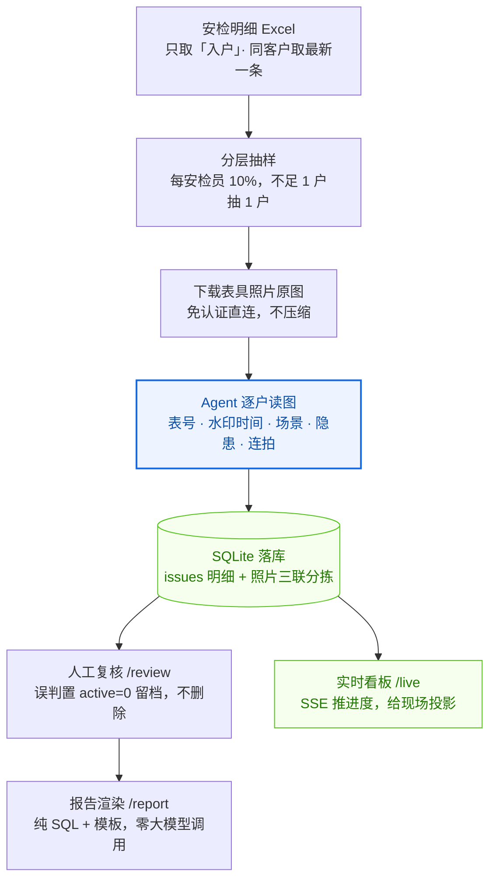

# 安检照片 AI 质检系统（Anjian AI QC）

> 燃气入户安检照片的**批量 AI 质检**：按安检员分层抽样 → 逐户读图判定 →
> 人工复核 → 出月度报告。
> 核心思路：**识别不用外部视觉 API，由 Agent（对话模型）亲自读图判定**，
> 程序只负责搬数据、下载、抽样、机械相似度计算、落库、渲染报告。



> 上图用 GitHub 原生 Mermaid 渲染，不依赖图床 —— 仓库内 `raw.githubusercontent.com`
> 的图片域名在部分网络下不可达，会显示成裂图。离线版见 [`assets/architecture.svg`](assets/architecture.svg)
> （矢量）与 [`assets/architecture.png`](assets/architecture.png)（2 倍图）。

> **接手部署的 Agent 请直接看 [`docs/部署交接.md`](docs/部署交接.md)** ——
> 里面有必须向用户采集的参数清单（分公司、照片列名、抽样口径、判定阈值）、改哪个文件、
> 以及真实数据跑通的验收标准。本文档是给人看的概览，那份是给 Agent 执行的 SOP。

---

## 它能查出什么

| 能查（可靠） | 判定级别 |
|---|---|
| 表号与档案不一致（读条形码下方印刷行，与 Excel 档案核对） | critical |
| 水印日期与工单时间差 ≥168 小时（7 天）——抓跨月复用旧照片 | critical |
| 手写工作单检查日期异常（未来日期 / 早于拍摄日期） | critical |
| 照片内容不是燃气安检现场 | critical |
| 照片明确可见重大隐患（热水器无烟道 / 装浴室 / 软管穿墙 / 表被封死…） | critical |
| 表号无法辨认（拍不清 / 未入镜 / 失焦） | warning |
| 同一检查项内多张照片疑似连拍凑数 | warning |
| 检查项错位（如「热水器」项拍的是安检工作单） | info |

**明确查不出、也不编**：软管老化程度、熄火保护针是否有效、报警器是否工作、
检漏结果、是否真实入户（照片只能证明画面状态，证明不了检查动作）。

**不作为判据**：模糊度（实测与可读性反相关）、手写「防霾卡号」（与表号是另一套编号体系）。

---

## 快速开始

### 1. 环境

```bash
python 3.9+            # 标准库即可跑服务；读图脚本需要下面这些
pip install -r requirements.txt
# config.json 可选：不存在时用内置默认值（抽样 10% / 阈值 168h / 端口 8790）
cp config.example.json ai/config.json
```

> 走「Agent 亲自读图」路线时**不需要 API Key**——识别由对话模型完成。
> 只有想让程序自己调外部视觉 API 时才在设置页填 Key。

### 2. 接入你自己的公司

打开 `ai/db.py`，改两处：

```python
COMPANY_ORDER = [          # (公司代码, 显示名)
    ("C1", "A 公司"),
    ("C2", "B 公司"),
]
```

再按你实际 Excel 的列名，调整各公司「表具照片 / 安检单照片」所在的 `items_code`：

```python
METER_ITEMS = {"C1": "items4"}     # 该公司表具照片所在项，默认 items2
FORM_ITEMS  = {"C1": "items0"}     # 该公司安检单照片所在项，默认 items1
```

> 为什么需要这张表：不同公司的安检系统给「同一业务含义」分配的 items 编号**不一样**，
> 硬编码 `items2` 会把某家的「安检过程中照片」误标成表具照片。

### 3. Excel 数据源要求

表头必须包含这些列（照片列只需列名里带「照片」或「图片」）：

```
客户编号 · 客户姓名 · 客户电话 · 客户类型 · 小区 · 客户地址
安检状态 · 到访不遇次数 · 安检时间 · 安检员
安检计划名称 · 安检计划类型 · 表类型 · 表品牌表型号 · 用气性质 · 表号 · 隐患明细
+ 若干「XX照片」列（值为图片 URL，多行分隔）
```

只处理 `安检状态 == 入户` 的行；同一客户编号取最新一条安检记录。

### 4. 启动

```bash
cd ai
python server.py          # 或双击根目录「启动质检系统.bat」
# 打开 http://127.0.0.1:8790/
```

### 5. 跑一次质检

**方式一：交给 Agent（推荐）**

把 `docs/SKILL.md` 作为工作流说明喂给具备读图能力的 Agent，然后说：

```
启动安检抽查 <xlsx 绝对路径>
```

Agent 会自动完成 导入 → 抽样 → 下载 → 亲自读图逐户判定 → 落库 → 出报告。

**方式二：命令行**

```bash
cd ai
python cli.py prepare --file "<xlsx>" --limit 0 --workers 6 --fresh  # 导入+抽样+下载
python scripts/batch.py pack --n 32 --company C1 --month 2026-09 --no-sheets
#    → 按 reports/_packs/b<N>/checklist.md 直读原图，写 reports/_batch<N>.json
python scripts/batch.py gap      --file reports/_batch<N>.json      # 水印间隔核算
python scripts/batch.py precheck --file reports/_batch<N>.json      # 提交前预检
python cli.py bulk               --file reports/_batch<N>.json      # 批量落库
python scripts/batch.py postcheck --batch <N> --payload reports/_batch<N>.json
python cli.py finish --month 2026-09
```

---

## 五个页面

| 页面 | 地址 | 用途 |
|---|---|---|
| 总览 | `/` | 各分公司进度卡片 + 断点续传状态 |
| 实时看板 | `/live` | 大字进度条 + 当前户 + 实时问题流，给领导投影用 |
| 人工复核 | `/review` | 逐户过有问题的人；三档按钮（`1` 误判 / `↑` 一般提示 / `↓` 严重提示 / `←` `→` 翻页）+ 现场问题多选标签 |
| 月度报告 | `/report` | 整体简报 + 各分公司卡片，可单家下载 |
| 设置 | `/settings` | 模型来源、抽样比例、并发、费用上限、待删保留天数 |

报告导出两个版本：

```bash
python cli.py report --company C1 --month 2026-09 --embed   # 单文件版，照片内嵌，可直接外发
python cli.py report --company C1 --month 2026-09           # 外链版，几百 KB，需联网看原图
```

---

## 判定口径（核心约定）

| 现象 | 级别 |
|---|---|
| 读出的表号 ≠ 档案表号 | critical |
| 表号无法辨认（一次读不出即记，不反复精查） | warning |
| 水印与工单时间差 **≥168 小时** | critical |
| 水印与工单时间差 **<168 小时** | 不标记（先拍照后补工单属正常） |
| 手写检查日期异常 | critical |
| 照片非燃气安检现场 | critical |
| 照片明确可见重大隐患 | critical |
| 同检查项照片连拍重复 | warning |
| 手写防霾卡号 / 表面积尘污渍 | 不查 |

**阈值单点**：168h 定义在 `ai/db.py: TIME_GAP_MIN`，改这一处全系统生效。

**一户一档、critical 优先**：同一户同时有 critical 与 warning 时只计入 critical
（取 `MIN(eff_severity)`，字符串序 `'critical' < 'warning'`），否则问题户数会重复计算。

### 三条铁律（错判比漏报更严重）

1. **读图直读表具照片原图（1 张/户）**，禁止用裁切带、联排拼图做主判定。
   裁切会切掉画面底部的表号，并让模型编造「表号在画面之外」的理由——
   实测把「表号无法辨认」率从 4% 抬到 60%+。
2. **读不出就填 `null` / `false`，绝不猜测补全。**
   表号读不出时**不要填 `meter_readable=false`**（程序会机械追加 critical），
   改为手写一条 warning issue。
3. **凡水印读数会翻转结论的户（跨月 / 超 7 天 / 边界带），必须放大复核后才定稿。**

---

## 项目结构

```
anjian-ai-qc/
├── ai/
│   ├── server.py           HTTP 服务（Python 标准库，零依赖）+ SSE 实时推送
│   ├── runner.py           编排：导入 → 抽样 → 下载 → 检测 → 分拣
│   ├── engine.py           判定规则 + 提示词 + 照片分拣
│   ├── db.py               SQLite（WAL）+ 口径常量 + 公司/items 映射  ← 接自己的数据改这里
│   ├── cli.py              Agent 通道命令行（prepare/next/submit/bulk/status/finish/report）
│   ├── report_data.py      报告数据层（分公司汇总、复核裁决）
│   ├── report_render.py    报告渲染（纯 SQL + 模板，零大模型调用）
│   ├── _bulk_many.py       批量落库助手（一次进程连续 bulk，失败自动重试）
│   ├── models/             模型适配层（OpenAI 兼容 / DeepSeek / 自定义中转）
│   ├── static/             前端页面（原生 HTML/CSS/JS，无构建步骤）
│   ├── scripts/
│   │   ├── batch.py        批处理：pack / gap / zoom / precheck / postcheck
│   │   ├── barcode*.py     条码解码交叉验证（pyzbar + zxingcpp）
│   │   ├── ocr_meter.py    OCR 读表号（RapidOCR）
│   │   ├── meter_band.py   自动定位表号带
│   │   ├── packpool.py     按 rid 池切分打包，避免重复领同一批户
│   │   └── acceptance.py   三轮验收（数据一致性 / 误判撤销 / 报告 / 接口健壮性）
│   ├── photos/             有问题的照片（证据留存，运行时生成）
│   ├── pending_delete/     无问题照片（30 天后清理，运行时生成）
│   ├── false_positive/     人工复核判「误判」的照片（永久留档，运行时生成）
│   └── reports/            批次材料与导出报告（运行时生成）
├── docs/
│   ├── 部署交接.md           ★ 给接手 Agent 的部署 SOP（含参数采集清单）
│   ├── SKILL.md            Agent 工作流说明（喂给 Agent 用）
│   └── 子代理并行读图.md    ≥300 户时的子代理并行方法论
├── assets/
│   ├── architecture.svg    架构图矢量版（可改，浏览器直接打开）
│   └── architecture.png    架构图 2 倍位图（README 正文用 Mermaid，此图供离线/分享）
├── config.example.json     配置模板（复制为 ai/config.json）
├── requirements.txt
├── 启动质检系统.bat
├── LICENSE
└── .gitignore
```

---

## 数据与隐私

- 所有数据（数据库、照片）**全部存本机**，除你主动配置的模型 API 外不上传任何第三方
- API Key 只写在本机 `ai/config.json`，不写进代码、不进报告
- 人工复核判「误判」的户，issues 不删除而是置 `active=0` 留档（`rev` 递增），
  审计日志写 `review_log`，支持撤销
- 每日首次启动自动备份数据库（保留 7 天，SQLite backup API，WAL 下安全）

---

## License

MIT
